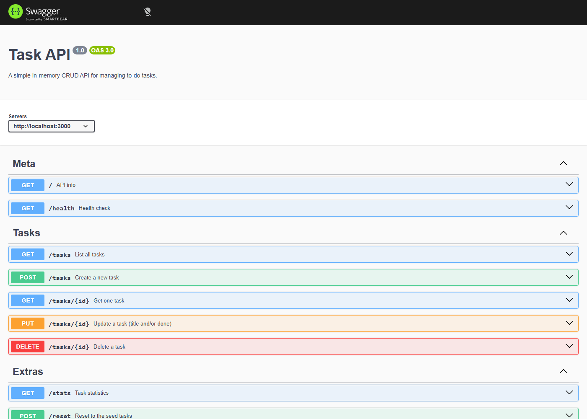
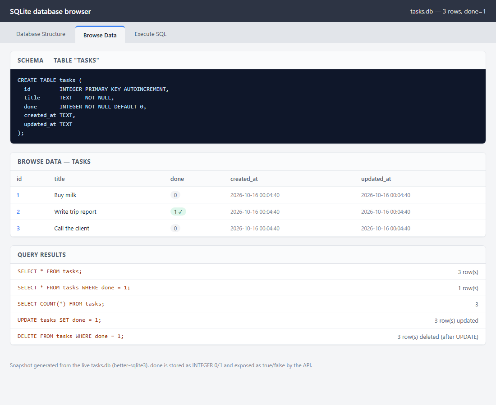

# Task API (SQLite)

REST API sederhana untuk mengelola daftar to-do. Dibuat dengan **Node.js + Express**, menyimpan data di **SQLite** (`tasks.db`), dan menyediakan **Swagger UI** di `/docs`.

Proyek ini adalah lanjutan tugas W2 · A1 → **W3 · A1**: mengganti penyimpanan in-memory dengan database SQLite. **Kontrak API tidak berubah** — hanya lapisan penyimpanannya.

```
Sebelum : Client → API → Array di memori
Sesudah : Client → API (Express) → db.js (lapisan data) → SQLite (tasks.db)
```

## Yang Berubah & Yang Tetap

| | Sebelum (W2) | Sekarang (W3) |
| --- | --- | --- |
| Penyimpanan | Array di memori | SQLite `tasks.db` |
| Persistensi | Hilang saat restart | **Tetap** setelah restart |
| Seed | Selalu di-reset di memori | Hanya jika tabel kosong |
| URL, body, status code | — | **Tidak berubah** |
| Format respons | `id`, `title`, `done` | Sama (+ `created_at`, `updated_at` aditif) |
| Swagger UI `/docs` | Ada | Ada |

## Alasan Memilih SQLite

- Berupa **satu file** (`tasks.db`), tanpa server database terpisah — cocok untuk pembelajaran dan mudah dipindah.
- **Dibuat otomatis** saat aplikasi pertama dijalankan; tidak ada langkah instalasi manual.
- Mendukung SQL standar (`SELECT`, `INSERT`, `UPDATE`, `DELETE`, `WHERE`, `COUNT`), sehingga saat pindah ke PostgreSQL/MySQL nanti konsepnya sama.
- Cepat dan tidak perlu konfigurasi (zero-config) untuk proyek kecil.

## Prasyarat

- **Node.js 18+** (diuji pada Node.js v22)
- npm

## Instalasi & Menjalankan

```bash
npm install && npm start
```

Server berjalan di `http://localhost:3000`. Dokumentasi interaktif di `http://localhost:3000/docs`.

Saat pertama kali dijalankan, aplikasi otomatis membuat `tasks.db`, tabel `tasks`, dan mengisi 3 task contoh **hanya jika tabel kosong**. Restart berulang tidak akan menggandakan data.

## Lokasi Database

File database: **`tasks.db`** di root proyek (path relatif terhadap folder proyek, dibuat dari `__dirname`). File ini **tidak** di-commit ke Git (lihat `.gitignore`) karena dibuat otomatis; setiap orang yang meng-clone cukup menjalankan `npm start`.

## Tabel Endpoint

| # | Method | Path | Implementasi SQL | Sukses | Error |
| - | ------ | ---- | ---------------- | ------ | ----- |
| 1 | GET | `/` | — | 200 | — |
| 2 | GET | `/health` | — | 200 | — |
| 3 | GET | `/tasks` | `SELECT * FROM tasks` | 200 | — |
| 4 | GET | `/tasks/:id` | `SELECT * FROM tasks WHERE id = ?` | 200 | 404 |
| 5 | POST | `/tasks` | `INSERT INTO tasks (title, done) VALUES (?, 0)` | 201 | 400 |
| 6 | PUT | `/tasks/:id` | `UPDATE tasks SET ... WHERE id = ?` | 200 | 400, 404 |
| 7 | DELETE | `/tasks/:id` | `DELETE FROM tasks WHERE id = ?` | 204 | 404 |
| — | GET | `/stats` | `SELECT COUNT(*) ...` (extras) | 200 | — |
| — | POST | `/reset` | hapus + seed ulang (extras) | 200 | — |
| — | GET | `/docs` | Swagger UI | 200 | — |

Setiap error mengembalikan JSON `{ "error": "<pesan>" }`. Pesan 404 memakai format lama `Task <id> not found` agar kontrak tidak berubah.

## Skema Database

```sql
CREATE TABLE tasks (
  id         INTEGER PRIMARY KEY AUTOINCREMENT,
  title      TEXT    NOT NULL,
  done       INTEGER NOT NULL DEFAULT 0,   -- SQLite tidak punya boolean: 0/1
  created_at TEXT,
  updated_at TEXT
);
```

Catatan: `done` disimpan sebagai integer `0`/`1`, lalu dikonversi kembali menjadi `true`/`false` pada respons JSON oleh lapisan API. Kolom `created_at`/`updated_at` ditambahkan lewat migrasi `ALTER TABLE` (dijelaskan di bagian Extras).

## Aturan Validasi

- **POST** — `title` wajib ada, bertipe string, dan tidak kosong (setelah di-trim). Jika tidak → **400**.
- **PUT** — body harus berisi minimal satu dari `title` atau `done`; `title` (jika ada) harus string tidak kosong, `done` (jika ada) harus boolean. Selain itu → **400**.
- `PUT` melakukan **update parsial**.
- Semua query memakai **parameterized query** (`?`), bukan menyambung string, agar terhindar dari SQL injection.

## Contoh `curl -i`

```bash
curl -i -X POST http://localhost:3000/tasks \
  -H "Content-Type: application/json" \
  -d '{"title":"Buy milk"}'
```

Output:

```
HTTP/1.1 201 Created
X-Powered-By: Express
Content-Type: application/json; charset=utf-8
Content-Length: 110
ETag: W/"6e-cnbZbwOaAL+vRDjTDSHRaAJ+L/8"
Date: Fri, 16 Oct 2026 00:03:46 GMT
Connection: keep-alive
Keep-Alive: timeout=5

{"id":4,"title":"Buy milk","done":false,"created_at":"2026-10-16 00:03:46","updated_at":"2026-10-16 00:03:46"}
```

Siklus CRUD lengkap via `curl`:

```bash
curl -i http://localhost:3000/tasks                 # 200 daftar
curl -i http://localhost:3000/tasks/1               # 200 satu task
curl -i http://localhost:3000/tasks/99              # 404 { "error": "Task 99 not found" }
curl -i -X POST http://localhost:3000/tasks -H "Content-Type: application/json" -d '{"title":"Buy milk"}'   # 201
curl -i -X POST http://localhost:3000/tasks -H "Content-Type: application/json" -d '{}'                     # 400
curl -i -X PUT http://localhost:3000/tasks/4 -H "Content-Type: application/json" -d '{"done":true}'         # 200
curl -i -X DELETE http://localhost:3000/tasks/4                                                             # 204
```

## Swagger UI

Semua endpoint terdokumentasi di **`http://localhost:3000/docs`** dan tombol **"Try it out"** menjalankan siklus CRUD penuh. Spesifikasi OpenAPI ada di `openapi.json`.



## Database Viewer



Snapshot di atas diambil dari `tasks.db` (struktur tabel + Browse Data + hasil query).

### Contoh query SQL dan hasilnya

```sql
SELECT * FROM tasks;
```

```
id  title               done
--  ------------------  ----
1   Buy milk            0
2   Write trip report   1
3   Call the client     0
```

Mengubah database secara manual langsung terlihat lewat API **tanpa restart**:

```sql
UPDATE tasks SET done = 1;   -- 3 rows changed
```

```bash
curl -s http://localhost:3000/tasks
# -> semua task berubah menjadi "done": true
```

Observasi lengkap ada di [`docs/sqlite-exploration.md`](docs/sqlite-exploration.md).

## Catatan: Data In-Memory vs Persisten

Data sekarang disimpan di SQLite, sehingga **tetap ada setelah server di-restart**. (Di assignment sebelumnya, data hilang setiap restart karena hidup di array memori.) Bukti: buat task, hentikan server (`Ctrl+C`), jalankan `npm start` lagi, lalu `GET /tasks` — task baru masih ada.

Karena database dibuat otomatis, `tasks.db` dimasukkan ke `.gitignore` agar repo bersih dan setiap orang mendapat database baru saat pertama kali menjalankan.

## Extras

- **Filter** — `GET /tasks?done=true` (klausa `WHERE`).
- **Search** — `GET /tasks?search=milk` (operator `LIKE`, case-insensitive untuk ASCII).
- **Sort** — `GET /tasks?sort=title` (klausa `ORDER BY ... COLLATE NOCASE`).
- **Stats** — `GET /stats` memakai `COUNT()` di SQL, bukan menghitung di JavaScript.
- **Reset** — `POST /reset` menghapus semua baris lalu memasukkan ulang 3 seed.
- **Timestamp** — kolom `created_at`/`updated_at` (migrasi `ALTER TABLE`, `updated_at` diperbarui tiap `PUT`).

## Struktur Proyek

```
.
├── index.js        # lapisan API (route Express) — tidak menyimpan data di memori
├── db.js           # lapisan data: koneksi, skema, migrasi, dan semua query SQL
├── openapi.json    # spesifikasi OpenAPI 3 untuk Swagger UI
├── package.json
├── tasks.db        # database SQLite (dibuat otomatis; di-ignore Git)
└── docs/
    ├── swagger.png          # screenshot Swagger UI
    ├── sqlite-viewer.png    # screenshot database viewer
    └── sqlite-exploration.md
```

## Lisensi

ISC
